# 回声游戏厅 · 每天一个小游戏

一组用 three.js 做的网页小游戏，打开就能玩，不用安装、不用登录。电脑、平板、手机的浏览器都支持。

**在线玩：<https://zhgarylu.github.io/everyday-game/>**

选题走的是接地气的生活梗：搓澡、摸鱼、挤地铁、相亲角、夜市套圈……每个游戏一局两到五分钟，操作方式各不相同。

## 游戏列表

| | 游戏 | 一句话 | 怎么玩 |
| --- | --- | --- | --- |
| 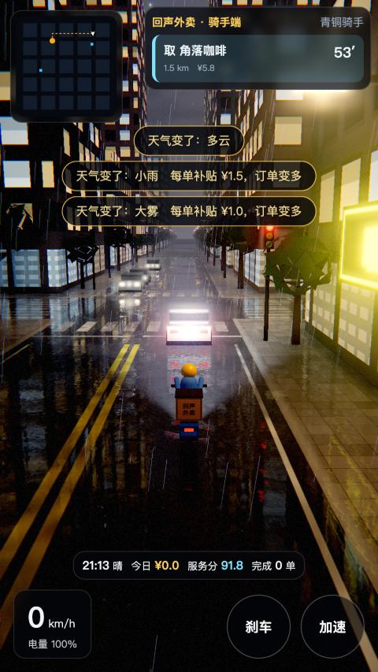 | **第 11 期 · 骑手**<br>[在线玩](https://zhgarylu.github.io/everyday-game/rider/) | 骑电动车在老城送外卖，从上午跑到深夜 | W 加速、S 刹车、A D 转向，Y 接单。跟着路面箭头走，停进光圈自动取餐送餐。平台给每单一个时限，你越准时它给得越紧；有昼夜、五种天气、车流和红绿灯，还有交警查车、学校限速抓拍、过马路的行人、施工占道、路边突然开的车门和高峰堵车；骑手有心情，会接到妈妈和顾客的电话。横竖屏都能玩 |
| 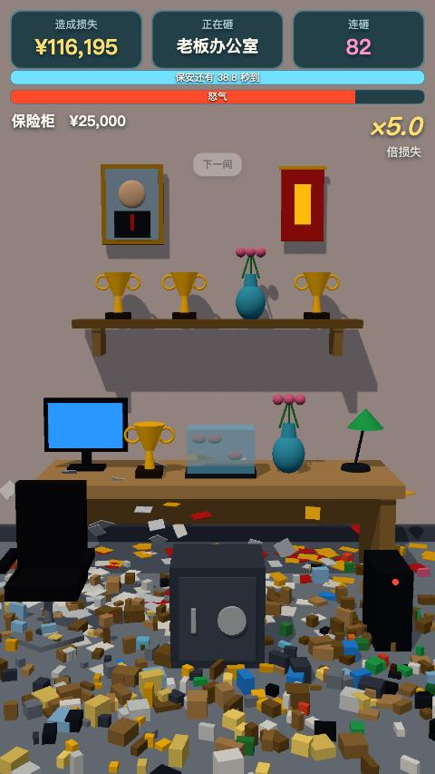 | **第 10 期 · 怒砸办公室**<br>[在线玩](https://zhgarylu.github.io/everyday-game/smash/) | 显示器、奖杯、打卡机、老板椅、保险柜，全部砸成渣 | 点哪砸哪，按住划过去一路砸。连砸涨倍数，怒气满了暴走，保安到之前尽量砸 |
| 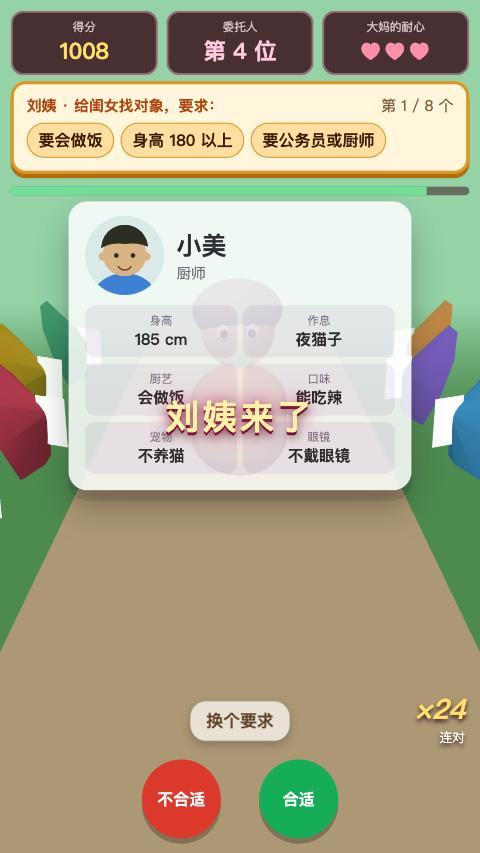 | **第 9 期 · 相亲角速配**<br>[在线玩](https://zhgarylu.github.io/everyday-game/match/) | 大妈报条件，你来判断候选人合不合适 | 全都符合往右划，有一条不符合往左划。条件越加越多、越来越绕 |
| 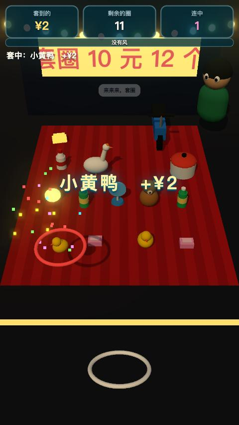 | **第 8 期 · 夜市套圈**<br>[在线玩](https://zhgarylu.github.io/everyday-game/ring/) | 10 块钱 12 个圈，圈住什么拿什么 | 按住往上拖瞄准，松手扔圈。越远越值钱，大鹅会走，老板会“脚滑” |
| 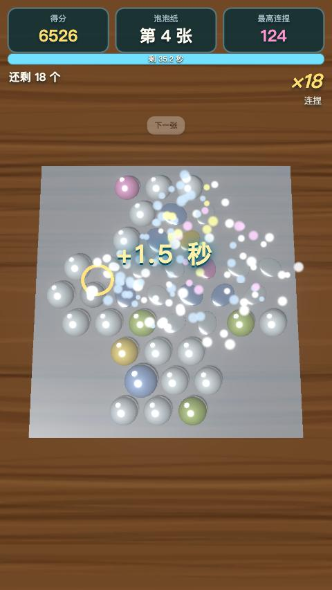 | **第 7 期 · 捏泡泡纸**<br>[在线玩](https://zhgarylu.github.io/everyday-game/pop/) | 啪啪啪，一张接一张 | 按住在泡泡上划。金泡加时间，连环泡炸一片，臭屁泡别碰 |
| 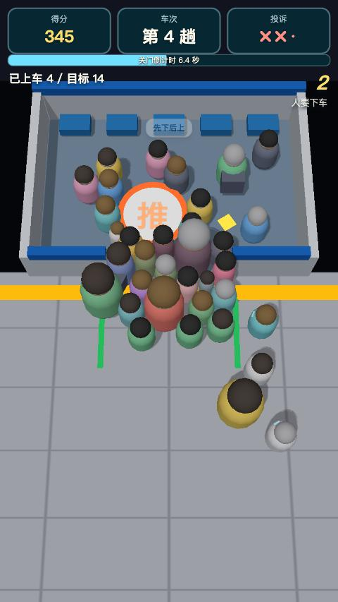 | **第 6 期 · 挤地铁**<br>[在线玩](https://zhgarylu.github.io/everyday-game/metro/) | 早高峰，把人塞进车厢 | 按住拖动推手往车门里推。要下车的先放出来，关门前塞够人数。途经 33 个出名拥挤的地铁站 |
| 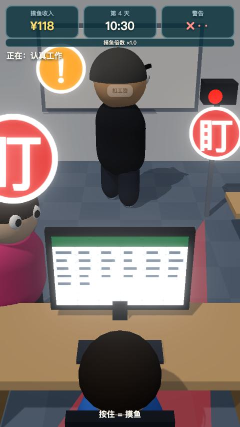 | **第 5 期 · 摸鱼大师**<br>[在线玩](https://zhgarylu.github.io/everyday-game/moyu/) | 按住摸鱼，松手装作在工作 | 只有一个操作：按住和松开。老板会回头、摄像头会亮红灯、HR 会路过，十八种摸鱼方式随机出现 |
| 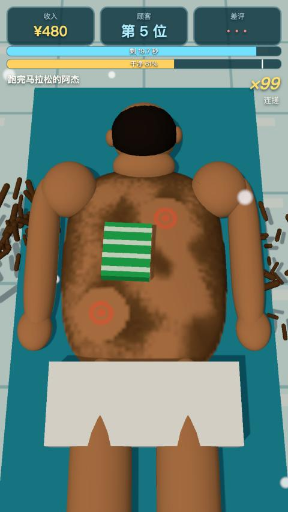 | **第 4 期 · 搓澡大师**<br>[在线玩](https://zhgarylu.github.io/everyday-game/scrub/) | 把顾客背上的泥搓成一根根泥条 | 按住在背上来回搓。躲开红色痛点，老泥多搓几遍，限时搓干净拿小费 |
| 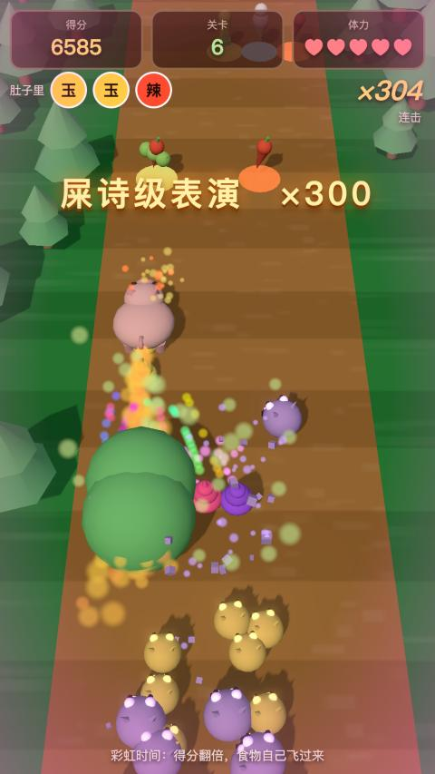 | **第 3 期 · 吃啥拉啥**<br>[在线玩](https://zhgarylu.github.io/everyday-game/eat/) | 吃什么就拉什么，砸翻身后的馋嘴怪 | 左右拖动小兽去吃食物：辣椒喷火、冰淇淋冰冻、西瓜拉出巨无霸。连吃三个一样的超级加倍 |
| 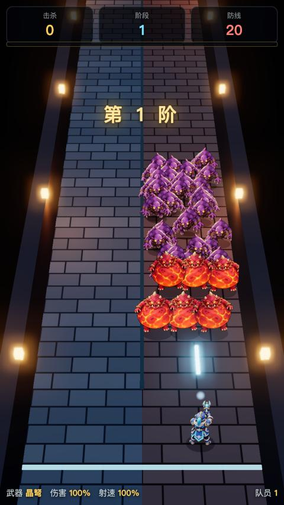 | **第 2 期 · 清潮**<br>[在线玩](https://zhgarylu.github.io/everyday-game/tide/) | 小队射击，清掉涌来的怪潮 | 左右拖动小队，自动开火。左边打冰块拿队员、武器和巨型帮手，右边清怪 |
| 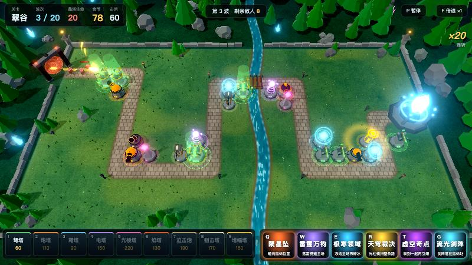 | **第 1 期 · 晶塔守卫**<br>[在线玩](https://zhgarylu.github.io/everyday-game/td/) | 塔防，大招华丽 | 沿路摆九种防御塔，攒能量放六个大招。四张地图逐关解锁。横屏，键盘鼠标更顺手 |

## 首页

首页按“每天一个小游戏”设计：

- **今日游戏**：当天上线的新游戏；没有新游戏的日子，在已上线的里面按天轮换。
- **上新日历**：一周七天，玩过当天的游戏就算打卡。
- **全部游戏**：可以搜索、按标签筛选、按上线时间或时长排序。
- **我的记录**：连续打卡天数、玩过几个、上次玩的是哪个。记录存在浏览器本地，不需要登录。

## 通用操作

- 所有游戏都能用鼠标或手指玩，没有需要键盘才能进行的操作（晶塔守卫用键盘更方便）。
- 声音要先点一下画面才会响，这是浏览器的限制。按 `M` 静音。
- 每个游戏的标题和结算界面左上角有“‹ 游戏厅”，可以回首页。

## 本地运行

```bash
git clone https://github.com/zhgarylu/everyday-game.git
cd everyday-game
python3 -m http.server 8123
```

然后打开 <http://localhost:8123/>。不需要安装任何依赖，用到的 three.js 文件已经放在 `vendor/three/` 里。任何能托管静态文件的服务都可以，直接双击打开 `index.html` 不行（浏览器不允许本地文件加载模块）。

## 目录结构

```
index.html  hub.js   首页
games.js             游戏清单：期数、上线日期、入口、标签、时长
covers/              封面图（实机截图）
td/ tide/ eat/ ...   每个游戏一个目录：index.html + game.js，语音在 voice/
rider/               骑手：world.js 城区和渲染、sim.js 平台模拟和心情、traffic.js 车流、hazards.js 交警行人等路况、game.js 骑行
tide/assets/         清潮的角色和图标素材，ASSET_SPEC.md 是素材规格说明
vendor/three/        three.js 0.170 中用到的文件
tools/gen_voice.py   预生成语音的脚本
```

## 加一个新游戏

1. 新建一个目录，放 `index.html` 和 `game.js`。
2. 在 `games.js` 里加一条：期数、上线日期、入口、标签、时长，以及怎么读它的最高分。
3. 封面图放进 `covers/`。
4. 开局时往 `localStorage` 的 `echo_hub` 里记一次打卡，标题界面加一个回首页的链接（照着任意一个现有游戏抄即可）。

首页的今日游戏、日历、列表和筛选标签会自动更新。

## 技术说明

- 渲染：three.js 0.170，后期用了泛光。模型大多是用基础几何体在代码里拼出来的，没有外部模型文件。
- 音效：全部用 Web Audio 实时合成，没有音效文件。
- 语音：各游戏 `voice/` 下的 mp3 是用火山引擎语音合成预先生成的。清潮之后的游戏用的是广西口音，晶塔守卫是陕西话。生成脚本依赖本机的合成工具和密钥，仓库里不包含。
- 每个游戏都留了一个调试入口（如 `window.__smash`），可以推进时间、让电脑代打，用来做自动测试。

## 关于制作

这个项目的代码、语音和大部分设计是和 Claude 一起做的；清潮里的角色图是另行生成后接入的。three.js 按 MIT 协议使用，许可见 `vendor/three/LICENSE`。
